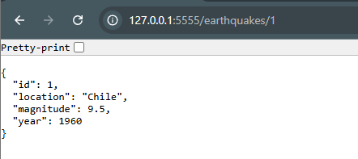
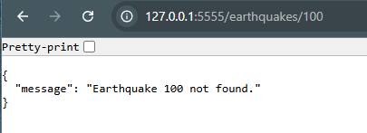
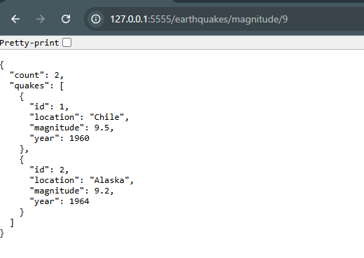
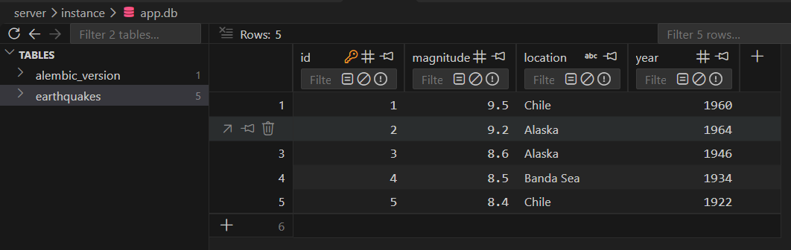
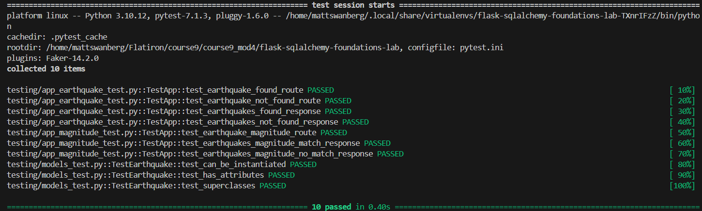

# Flask-SQLAlchemy Foundations - Earthquake Data

## Overview

A RESTful API built with Flask, Flask-SQLAlchemy, and SQLite to manage and retrieve historical earthquake data.

This project was developed as part of the Flask-SQLAlchemy Lab 1 assignment. It demonstrates database modeling, schema migrations, data seeding, SQLAlchemy queries, and JSON API responses.

The application allows users to retrieve individual earthquake records by ID or filter multiple earthquakes based on a minimum magnitude threshold.

## Features

- **Earthquake Database Model:** Stores earthquake IDs, magnitudes, locations, and years using SQLAlchemy ORM.
- **Database Migrations:** Uses Flask-Migrate and Alembic to manage database schema changes.
- **Database Seeding:** Populates the database with five historical earthquake records.
- **Earthquake Lookup:** Retrieves individual earthquakes by their unique ID.
- **Magnitude Filtering:** Retrieves earthquakes greater than or equal to a specified magnitude.
- **Flexible URL Parameters:** Supports both integer and floating-point magnitude values.
- **JSON Responses:** Returns structured earthquake data for frontend integration.
- **HTTP Status Codes:** Handles successful requests (200) and missing earthquake records (404).
- **Automated Testing:** Uses Pytest to validate models and API functionality.

## Technologies Used

- Python
- Flask
- Flask-SQLAlchemy
- SQLAlchemy ORM
- SQLite
- Flask-Migrate
- Alembic
- Pytest
- Pipenv

## Project Structure

```text
flask-sqlalchemy-foundations-lab/
├── server/
│   ├── app.py
│   ├── models.py
│   ├── seed.py
│   ├── instance/
│   │   └── app.db
│   ├── migrations/
│   │   ├── versions/
│   │   │   └── 5afc3345ca1c_initial_migration.py
│   │   ├── alembic.ini
│   │   ├── env.py
│   │   ├── README
│   │   └── script.py.mako
│   └── testing/
│       ├── models_test.py
│       ├── app_earthquake_test.py
│       └── app_magnitude_test.py
├── Pipfile
├── Pipfile.lock
├── .gitignore
└── README.md
```

**Note:** The SQLite database is generated locally and excluded from version control through `.gitignore`. Migration scripts remain tracked so the database schema can be recreated.

## Installation and Setup

### 1. Clone the Repository

```bash
git clone <https://github.com/Matt20Swanberg/flask-sqlalchemy-foundations-lab>
cd flask-sqlalchemy-foundations-lab
```

### 2. Install Dependencies

Install the project's dependencies using Pipenv:

```bash
pipenv install
```

Activate the virtual environment:

```bash
pipenv shell
```

### 3. Configure Flask

Navigate into the server directory:

```bash
cd server
```

Set the Flask application and development port:

```bash
export FLASK_APP=app.py
export FLASK_RUN_PORT=5555
```

### 4. Initialize the Database

The project includes Alembic migration files.

Apply the existing migrations to create the database schema:

```bash
flask db upgrade head
```

This creates the SQLite database and the `earthquakes` table.

**Note:** The migration environment is already included in the repository. Running `flask db init` again is not necessary.

### 5. Seed the Database

Populate the database with sample earthquake records:

```bash
python seed.py
```

The seed script inserts five historical earthquake records.

| ID | Magnitude | Location  | Year |
|----|-----------|-----------|------|
| 1  | 9.5       | Chile     | 1960 |
| 2  | 9.2       | Alaska    | 1964 |
| 3  | 8.6       | Alaska    | 1946 |
| 4  | 8.5       | Banda Sea | 1934 |
| 5  | 8.4       | Chile     | 1922 |

IDs shown above reflect the expected order when seeding a fresh database.

**Important:** Running `seed.py` deletes existing earthquake records before inserting the sample data.

### 6. Start the Flask Server

Run:

```bash
flask run --port 5555 --debug
```

The API will be available at:

```text
http://127.0.0.1:5555
```

## Database Model

The application uses SQLAlchemy ORM to represent earthquake records as Python objects.

### Earthquake Model

The `Earthquake` model maps to the `earthquakes` database table.

| Attribute | Data Type | Description |
|---|---|---|
| id | Integer | Unique primary key |
| magnitude | Float | Recorded earthquake magnitude |
| location | String | Geographic location |
| year | Integer | Year of occurrence |

The model also implements a `__repr__()` method to provide a readable representation of each earthquake.

Example:

```text
<Earthquake 1, 9.5, Chile, 1960>
```

## API Endpoints

### 1. Home Endpoint

**Method:** `GET`

**Route:**

```text
/
```

Returns a welcome message confirming the API is running.

**Example Response:**

```json
{
  "message": "Flask SQLAlchemy Lab 1"
}
```

**HTTP Status:** `200 OK`

---

### 2. Retrieve Earthquake by ID

**Method:** `GET`

**Route:**

```text
/earthquakes/<int:id>
```

Retrieves a single earthquake using its unique database ID.

**Example Request:**

```text
http://127.0.0.1:5555/earthquakes/2
```

**Example Response:**

```json
{
  "id": 2,
  "magnitude": 9.2,
  "location": "Alaska",
  "year": 1964
}
```

**HTTP Status:** `200 OK`

#### Earthquake Not Found

If the requested earthquake does not exist, the API returns an error message.

**Example Request:**

```text
http://127.0.0.1:5555/earthquakes/9999
```

**Example Response:**

```json
{
  "message": "Earthquake 9999 not found."
}
```

**HTTP Status:** `404 Not Found`

---

### 3. Filter Earthquakes by Magnitude

**Method:** `GET`

**Routes:**

```text
/earthquakes/magnitude/<float:magnitude>
/earthquakes/magnitude/<int:magnitude>
```

Retrieves all earthquakes with magnitudes greater than or equal to the requested threshold.

Both integer and floating-point values are supported.

**Example Requests:**

```text
http://127.0.0.1:5555/earthquakes/magnitude/9
```

```text
http://127.0.0.1:5555/earthquakes/magnitude/9.0
```

Both requests return the same matching earthquake records.

**Example Response:**

```json
{
  "count": 2,
  "quakes": [
    {
      "id": 1,
      "magnitude": 9.5,
      "location": "Chile",
      "year": 1960
    },
    {
      "id": 2,
      "magnitude": 9.2,
      "location": "Alaska",
      "year": 1964
    }
  ]
}
```

**HTTP Status:** `200 OK`

#### No Matching Earthquakes

If no earthquakes meet the requested magnitude, the API returns an empty list.

**Example Request:**

```text
http://127.0.0.1:5555/earthquakes/magnitude/10.0
```

**Example Response:**

```json
{
  "count": 0,
  "quakes": []
}
```

**HTTP Status:** `200 OK`

Unlike the earthquake-by-ID endpoint, an empty magnitude search is considered a successful request.

## SQLAlchemy Queries

The application uses SQLAlchemy ORM queries to retrieve earthquake data.

### Retrieve an Earthquake by ID

```python
Earthquake.query.filter(Earthquake.id == id).first()
```

This query retrieves the first earthquake matching the requested ID.

If no matching record exists, `.first()` returns `None`.

### Filter Earthquakes by Magnitude

```python
Earthquake.query.filter(
    Earthquake.magnitude >= magnitude
).all()
```

This query retrieves all earthquake records whose magnitude meets or exceeds the requested threshold.

The resulting SQLAlchemy objects are converted into dictionaries before being returned as JSON.

## Database Migrations

Flask-Migrate and Alembic are used to manage database schema changes.

### Initialize a New Migration Environment

For a new project without an existing migration directory:

```bash
flask db init
```

### Generate a Migration

After modifying database models:

```bash
flask db migrate -m "description of changes"
```

### Apply Migrations

```bash
flask db upgrade head
```

### View the Current Revision

```bash
flask db current
```

Migration files are maintained in:

```text
server/migrations/versions/
```

This allows database schema changes to be tracked through version control.

## Testing

The application includes automated tests using Pytest.

### Run All Tests

From the `server` directory:

```bash
pytest -v
```

### Run Individual Test Suites

**Earthquake Model Tests:**

```bash
pytest testing/models_test.py -v
```

**Earthquake-by-ID API Tests:**

```bash
pytest testing/app_earthquake_test.py -v
```

**Magnitude Filtering API Tests:**

```bash
pytest testing/app_magnitude_test.py -v
```

### Test Results

All 10 tests passed successfully.

```text
================== 10 passed ==================
```

The tests validate:

- SQLAlchemy model behavior
- Earthquake lookup by ID
- Successful JSON responses
- HTTP 404 handling for missing earthquakes
- Magnitude filtering
- Matching earthquake counts
- Empty query results

## Time Complexity (Big O)

The application uses SQLAlchemy ORM to execute database queries rather than manually iterating through every database record in Python.

The following estimates describe the operations involved in retrieving and preparing earthquake data.

| Operation | Approximate Complexity | Explanation |
|---|---|---|
| Lookup by primary key | O(log n) | Typical indexed database lookup; actual performance depends on the database engine and query plan |
| Magnitude filtering | O(n) | A full table scan may be required without a magnitude index |
| Convert matching records to dictionaries | O(k) | Processes each matching earthquake once |
| Count matching records using `len()` | O(1) | Retrieves the length of the existing Python list |
| Construct JSON response | O(k) | Response size grows with the number of matching records |

Where:

- `n` = Total number of earthquake records in the database.
- `k` = Number of earthquakes matching the magnitude threshold.

### Performance Considerations

The earthquake ID is defined as the table's primary key, allowing efficient record retrieval.

Magnitude filtering currently processes all matching records returned by the database.

For larger datasets, performance could potentially be improved by:

- Adding an index to the magnitude column.
- Implementing pagination for large result sets.
- Limiting the number of records returned per request.
- Using database-level aggregation when only counts are needed.

These optimizations are not required for the current assignment.


### Screenshots

The following screenshots demonstrate the functionality of the Earthquake API and successful test execution.

#### 1A. Earthquake Lookup by ID

Demonstrates retrieving an individual earthquake using its unique ID.

```text
http://127.0.0.1:5555/earthquakes/1
```



### 1B. Earthquake Lookup by ID Not Found

```text
http://127.0.0.1:5555/earthquakes/100
```



#### 2. Earthquake Magnitude Filtering

```text
http://127.0.0.1:5555/earthquakes/magnitude/9.0
```

Demonstrates filtering earthquake records by a minimum magnitude.



#### 3. SQLite Database

Displays the earthquake records stored in the SQLite database.



#### 4. Successful Test Suite

Shows the results of running the automated Pytest suite, with all 10 tests passing.



## Author

Created by Matthew Swanberg as part of Course 9 Module 4 (Flask-SQLAlchemy Foundations - Earthquake Data)